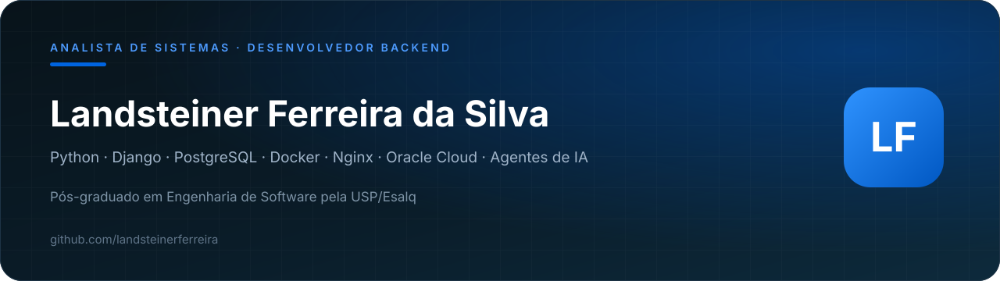

 

## Sobre

Analista de Sistemas e Desenvolvedor Backend, pós-graduado em Engenharia de Software pela USP/Esalq. Construo aplicações web em Python e Django que rodam em produção, com PostgreSQL, Docker, Nginx e uWSGI em servidor na Oracle Cloud.

O trabalho vai do problema ao sistema no ar: modelagem de dados multi-tenant, controle de acesso por perfil, API REST e integração com serviços externos. Também desenvolvo automações com agentes de IA para leitura de documentos, geração de relatórios e atendimento em canais como Telegram e e-mail.

A maior parte do meu código está em repositórios privados, de sistemas internos e de clientes. O que é público está organizado aqui.

## Sistemas em produção

| Sistema | O que faz | Stack | Acesso |
| --- | --- | --- | --- |
| **Solicita Cidadão** (SGU) | Gestão urbana e interação cidadã: registro de solicitações, mapa, acompanhamento por protocolo e área administrativa | Django, PostgreSQL, Leaflet, Nginx | [solicitacidadao.duckdns.org](https://solicitacidadao.duckdns.org/) |
| **Solicita Cidadão** (SaaS) | Versão multiusuário do mesmo domínio, com separação por tenant, autenticação por perfil e painel de gestão | Django, PostgreSQL, multi-tenant | [solicitacidade.duckdns.org](https://solicitacidade.duckdns.org/) |

Os repositórios privados guardam os demais sistemas que mantenho, entre eles gestão organizacional com assistente de IA sobre a base de dados, plataforma de sorteio com motor próprio e rotinas automatizadas de monitoramento com alerta em canal de mensagem.

## Stack

## Formação

| Curso | Instituição |
| --- | --- |
| Pós-graduação em Engenharia de Software, concluída em 2026 | MBA USP/Esalq |
| Análise e Desenvolvimento de Sistemas | Unopar |
| Engenharia Elétrica | Instituto Federal Goiano |
| Técnico em Eletrotécnica | Instituto Federal Goiano |

## Contato

Aberto a conversas sobre desenvolvimento backend em Python, integração de sistemas e automação de processos com IA.

- LinkedIn: [landsteiner-ferreira-da-silva](https://www.linkedin.com/in/landsteiner-ferreira-da-silva-6ba49953)
- E-mail: [landsteinerferreira@hotmail.com](mailto:landsteinerferreira@hotmail.com)
